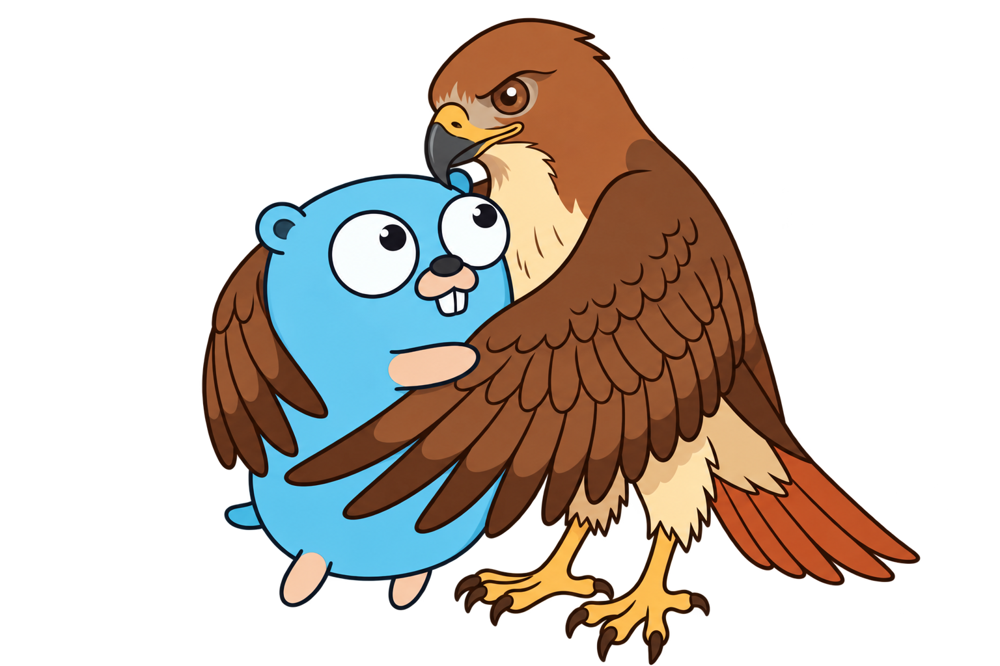

<p align="center">
  
</p>

# gohawk

[](https://github.com/kojah/gohawk/actions/workflows/ci.yml)
[](https://github.com/kojah/gohawk/actions/workflows/go-1.26.yml)
[](https://github.com/kojah/gohawk/actions/workflows/ci.yml)
[](https://github.com/kojah/gohawk/actions/workflows/ci.yml)
[](https://github.com/kojah/gohawk/actions/workflows/ci.yml)
[](https://github.com/kojah/gohawk/actions/workflows/pages.yml)
[](https://github.com/kojah/gohawk/actions/workflows/links.yml)

gohawk is an industrial-grade static analyzer that finds resource management
and concurrency issues in Go code. It has been used to find and fix bugs in
[Docker](https://github.com/moby/moby/pull/53517),
[Kubernetes](https://github.com/kubernetes/kubernetes/pull/142429), and
[Caddy](https://github.com/caddyserver/caddy/pull/7968).

gohawk is heavily inspired by Meta's [Infer](https://fbinfer.com/) and its
compositional summary model. It writes a summary of what each function does
with its arguments and results, such as closing a file or waiting for a
goroutine, and callers read that summary instead of analyzing the function
again. This lets gohawk follow a resource through helpers and across packages.

[Read the documentation](https://gohawk.dev/)

## Quick Start

Download a binary from [GitHub Releases](https://github.com/kojah/gohawk/releases)
and put it on your `PATH`. For source builds, see [installation](docs/installation.md).

```sh
# Run the conservative default set.
gohawk ./...

# See every analyzer with its tier and group.
gohawk list

# Inspect an analyzer or one of its checks.
gohawk doc lockorder
gohawk doc lockorder/missing-release

# Use it with go vet.
go vet -vettool="$(command -v gohawk)" ./...

# Run a selected analyzer, or exclude one from the defaults.
gohawk -enable=concurrentcapture ./...
gohawk -disable=concurrentcapture ./...

# Run complete analyzer groups with their default checks.
gohawk -enable-groups=concurrency,resources ./...

# Run one experimental check by its ID.
gohawk -enable-checks=producerlifecycle/unclosed-range ./...

# Remove groups from the ordinary run or from -enable-all.
gohawk -disable-groups=concurrency ./...

# Run every analyzer and check.
gohawk -enable-all ./...
```

## How gohawk compares to other analyzers

gohawk aims to complement other Go analyzers, not replace them. Deep, flow-based analysis of Go already covers several domains well.
[NilAway](https://github.com/uber-go/nilaway) covers nil safety,
[gosec](https://github.com/securego/gosec) covers security and taint
analysis, and [Staticcheck](https://staticcheck.dev/) covers a broad range of
general bugs. gohawk primarily focuses on resource management and concurrency, which is uncovered ground.

## golangci-lint integration

There is no native GolangCI lint integration (yet!), but gohawk can run as a module plugin inside a custom golangci-lint binary. See the
[golangci-lint integration guide](https://gohawk.dev/golangci-lint/)
for build and configuration instructions.

## Contributing

Contributions are welcome. See [How to contribute](https://gohawk.dev/contributing/)
for the development workflow, analyzer requirements, and verification steps.

## Contributors

Thanks to everyone who contributes to gohawk. This image of commit contributors
is refreshed daily.

[](https://github.com/kojah/gohawk/graphs/contributors)

See the [full contributor history](https://github.com/kojah/gohawk/graphs/contributors).

## AI policy

gohawk was developed with assistance from LLMs, and AI-assisted contributions
are permitted. Contributors must disclose AI usage, and every contribution must
meet the project's strict standards for quality, testing, analyzer precision,
and human readability. See the full [AI policy](https://gohawk.dev/ai-policy/).

## License

Licensed under the MIT License.
