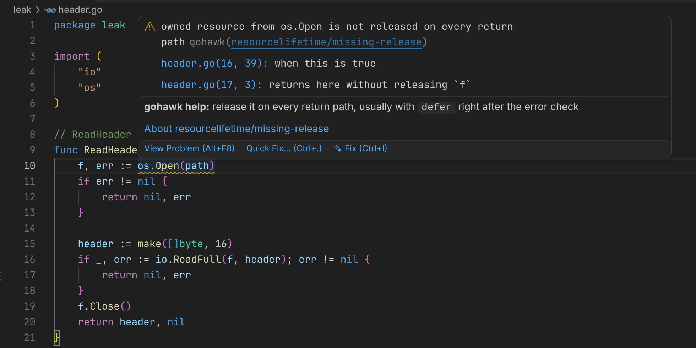
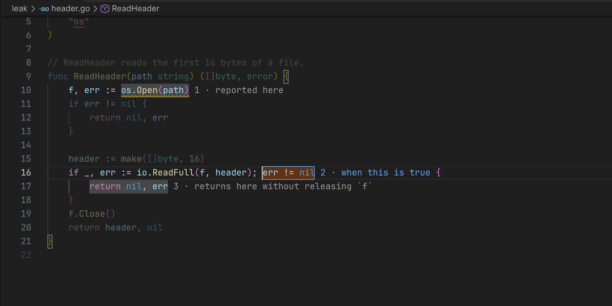

# gohawk for VS Code

Shows [gohawk](https://gohawk.dev) findings in the editor: resources that are
not released on every return path, contradictory lock orders, goroutines
nothing waits for, and more. Each finding carries the path that proves it.

- Findings appear shortly after you stop typing, including in unsaved files.
- Hover a finding for the usual fix; use the lightbulb to step through the
  reported path or to see the full evidence.
- gohawk only reports. It never edits your code.

It runs beside the official Go extension and does not replace it.

## Follow the path

Put the cursor on a finding, open the lightbulb menu, and pick **Step through
the reported path**. Everything that is not part of the path is dimmed and
each step is numbered. `Alt+]` and `Alt+[` move between steps; `Esc` exits.

## How it works

The extension starts `gohawk lsp`, a small process that holds no analysis
state. Each check runs `go vet` with gohawk as its tool and exits when done,
so analysis memory is released between checks.

## Settings

| Setting                | Default                | Meaning                                                                           |
| ---------------------- | ---------------------- | --------------------------------------------------------------------------------- |
| `gohawk.run`           | `onPause`              | When to check: `onPause`, `onSave`, or `manual`.                                  |
| `gohawk.debounce`      | `750`                  | Milliseconds after the last keystroke.                                            |
| `gohawk.scope`         | `packageThenImporters` | What to check after an edit.                                                      |
| `gohawk.experimental`  | `false`                | Include experimental checks.                                                      |
| `gohawk.memoryLimit`   | `2GiB`                 | Memory limit for one check.                                                       |
| `gohawk.maxParallel`   | `2`                    | Packages a background check analyzes at once.                                     |
| `gohawk.timeout`       | `60`                   | Seconds a check may go without finishing a package.                               |
| `gohawk.importerLimit` | `50`                   | Most importers re-checked after an edit; beyond it, only open ones.               |
| `gohawk.path`          | empty                  | Path to your own gohawk binary. Empty uses the one that ships with the extension. |

Test files (`_test.go`) are not analyzed.

## Large projects

The first check in a project also analyzes its dependencies. On a very large
project this takes a few minutes, once; the status bar shows the progress. If
checks feel slow while you type, set `gohawk.run` to `onSave`.

## More

Documentation for every check is at [gohawk.dev](https://gohawk.dev). Report
problems at [github.com/kojah/gohawk](https://github.com/kojah/gohawk/issues).
