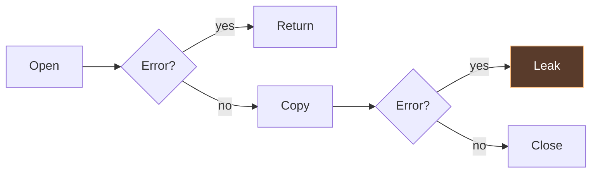
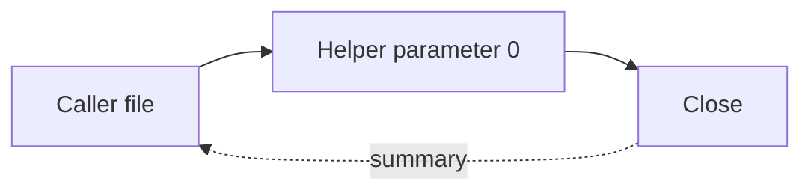

<div class="hero">
<div>
<div class="eyebrow">GolangNYC · James Ko</div>
<h1>Resource ownership<br>in Go</h1>
<p class="subtitle"><strong>gohawk</strong></p>
</div>

</div>

<!--
SECTION 1 — 10 minutes total, slides 1–7. Elapsed target: 10:00.
Spend about 30 seconds. Introduce yourself and the project in your own words.
This talk assumes familiarity with Go functions, errors, defer, and goroutines.
The question for the hour: when a function starts something, who owns finishing it?
No live network or running external worker is needed for any example.
-->

---

# File cleanup example

<<< @/examples/resources.go#leaky

<!--
Context for the speaker: Read a short header, then close the file. Take 30 seconds.

Spend about 1 minute 30 seconds. Pause before explaining anything. Ask for a show of hands:
who sees a problem, and on which line? Let someone describe the error path.
This is an actual compiled snippet, shared with the example validation.
Do not claim Close errors never matter: the happy path deliberately returns its error.
-->

---

# Return paths



<!--
Context for the speaker: The obligation begins after acquisition succeeds.

Spend about 1 minute. Walk the picture with the audience. Open failure creates no
file cleanup obligation. The lower copy-error branch is the witness for this bug.
Explain what path-sensitive means using this picture before introducing the term.
Static analysis considers code paths without waiting for production to take them.
-->

---

# Deferred cleanup

<<< @/examples/resources.go#fixed {6}

<!--
Context for the speaker: For this read-only example, defer covers both later returns.

Spend about 1 minute. Defer moves the duty to function exit, immediately
after success. The file is used for reading, so this example ignores the deferred
Close error. Write/flush/commit code may need to preserve a finalization error.
Acknowledge the obvious objection: yes, defer is the right habit here.
Now ask what happens when this function must return the file still open.
-->

---

# Returning an open file

<<< @/examples/resources.go#validation-leak

<!--
Spend about 1 minute 30 seconds. Let the audience read the whole function before pointing
at any lines. It reads a four-byte header and returns the file positioned for the
caller to continue reading. Ask where cleanup belongs and allow time for answers.
-->

---

# Ownership on each return path

<<< @/examples/resources.go#validation-leak {8-11}

<!--
Spend about 1 minute 30 seconds. This function reads a four-byte header and returns the
open file, positioned for the caller to continue reading. A short file makes
ReadFull fail. Which return still owns the file? Let the audience explain it.
Adding defer file.Close immediately after Open would close the returned file on
success. Returning the file transfers ownership only on the successful path;
returning nil with an error leaves this function responsible for closing it.
The analyzer reports this missing-release example in the validated examples.
-->

---

# Cleanup and ownership transfer

<<< @/examples/resources.go#validation-fixed {8,11}

<!--
Spend about 3 minutes. On failure, close before returning the error. On success,
return the live file and let the caller own Close. The read failure is the primary
error; this read-only example deliberately ignores a secondary Close error.
The header read is intentionally minimal: it establishes that four bytes exist,
not that they match a particular format. The caller continues after those bytes.
This accepted form is analyzed beside the leaking form. The useful question is
which paths still owe cleanup, rather than whether the function contains defer.
Bridge to gohawk: keep that ownership question in mind across helpers and packages.
-->

---

# Resource lifetime diagnostic

<div class="terminal">
<p>owned resource from os.Open is not<br>released on every return path</p>
</div>

<!--
SECTION 2 — 8 minutes total, slides 8–11. Elapsed target: 18:00.
Context for the speaker: Check: resourcelifetime/missing-release · message text from the analyzer

Spend about 2 minutes. This is the actual message, presented without terminal
chrome or a fabricated line number. The analyzer can attach related return-path
evidence. Run the checked examples later if time allows; the deck is self-contained.
Source: internal/analysis/analyzers/resources/resourcelifetime/analyzer.go.
-->

---

# Lifecycle obligations

<div class="steps">
<div class="step"><b>FILE</b><span>Close</span></div>
<div class="step"><b>TRANSACTION</b><span>Commit / rollback</span></div>
<div class="step"><b>WORKER</b><span>Join</span></div>
<div class="step"><b>PROCESS</b><span>Wait</span></div>
</div>

<!--
Context for the speaker: Each check has its own contracts and limits. Process ownership is experimental.

Spend about 1 minute 30 seconds. These are analogies, not interchangeable operations.
Cancel requests a stop; it does not generally establish worker completion.
SQL rows and statements are also covered resource families. Stay with the four
rows rather than turning the talk into the entire analyzer catalog.
Sources: public resourcelifetime, goroutineownership and processownership pages.
-->

---

# Worker completion

<<< @/examples/workers.go#unjoined

<!--
Context for the speaker: The worker promises Done. Who waits for it?

Spend about 2 minutes 30 seconds. A callback is supplied so no fake updateCache body is
needed. The callback may do arbitrary work; the visible deferred Done establishes
the completion mechanism. The launching function returns with no Wait.
Do not say every goroutine without Wait is reported. A recognizable completion
obligation is the positive evidence this check starts from.
-->

---

# Waiting for workers

<<< @/examples/workers.go#joined {9}

<!--
Context for the speaker: Joining is one part of lifecycle design. Blocking work still needs a way to stop.

Spend about 2 minutes. Wait makes completion observable before returning. This is
suitable for finite work; it does not solve cancellation of an indefinitely blocked
callback. Discuss errors, cancellation and errgroup verbally if asked.
The accepted example is checked against the same analyzer as the bad example.
-->

---

# Cleanup in a helper

<<< @/examples/resources.go#helpers

<!--
SECTION 3 — 13 minutes total, slides 12–16. Elapsed target: 31:00.
Context for the speaker: The cleanup action is inside closeFile, not the caller.

Spend about 3 minutes. Ask whether a search for the text file.Close in the caller
would understand this example. It would not. Explain that this is still an ordinary
accepted form: the helper releases the exact argument supplied by this caller.
The example is imported directly from the validated Go source.
-->

---

# Function summaries



<p class="subtitle">The summary applies to the exact argument passed by the caller</p>

<!--
Spend about 3 minutes. A function summary records selected behavior rather than
copying the helper's implementation into each caller. Here the helper closes
parameter 0, and the caller binds that parameter to this file. Closing an unrelated
file would not settle the obligation. A helper could conditionally close or retain
its input, so a name like closeFile alone is insufficient evidence.
This diagram is a conceptual projection, not the serialized summary or full alias
model. Lifecycle facts can be exported across package boundaries; exported
parameter guarantees still need to be bound to the actual caller values.
Source: docs/development/fact-model.md and docs/architecture.md.
-->

---

# Static single assignment

```text
file₁, err₁ = Open(path)
if err₁ != nil → return
copyErr₁ = CopyN(dst, file₁, 64)
if copyErr₁ != nil → return     ← file₁ still owed
Close(file₁)
```

<!--
Context for the speaker: Teaching notation, not a literal dump of Go’s SSA representation.

Spend about 2 minutes 30 seconds. Define SSA before using the abbreviation elsewhere.
Real Go SSA represents tuple calls and extracts separately; this slide intentionally
uses readable pseudocode. Explain that the analyzer can distinguish a reassigned
variable from the original resource. Branch joins and aliasing add complexity;
we will not derive the whole intermediate representation on stage.
-->

---

# Lifecycle analysis

<div class="steps">
<div class="step"><span>Obligation</span></div>
<div class="step"><span>Actions</span></div>
<div class="step"><span>Returns</span></div>
</div>

<p class="subtitle">Cleanup and transfer settle local ownership<br>Opaque handoffs leave ownership unknown</p>

<!--
Spend about 2 minutes 30 seconds. This is the lifecycle architecture, simplified
for the room. Each analyzer supplies its own evidence rules. Some classifiers
call exact completion a join; cleanup and transfer are separate action labels.
One authoritative flow result drives reporting and tracing. Avoid suggesting
every analyzer shares an identical implementation or traversal.
An opaque handoff is positive evidence of uncertain ownership, not evidence that
cleanup happened. Unknown suppresses a diagnostic. A separate early-return path
still needs its own classification; one handoff does not excuse every path.
Source: docs/architecture.md, lifecycle analyzer section.
-->

---

# Package analysis with go vet

<div class="terminal">
<p>gohawk ./...<br>  → go vet -vettool=… -json<br>  → package analysis + cached facts<br>  → diagnostics</p>
</div>

<p class="subtitle">Dependencies publish summaries for their callers</p>

<!--
Spend about 2 minutes. Connect the helper summary to cross-package analysis.
Selected domains publish separate result, lifecycle and concurrency knowledge.
The summary broker lets analyzers request what they need; available facts may
still not answer a particular question. Guarantees need actual argument binding.
Package-local SSA and reusable facts avoid loading whole-program SSA at once.
The command delegates package scheduling and caching to go vet, then processes
diagnostics. Cache invalidation follows source, dependency and tool changes.
Avoid memory or speed numbers without a pinned measurement.
Source: docs/architecture.md and docs/development/fact-model.md.
-->

---

# Diagnostic precision

<div class="two">
<div class="panel">
<h2>Report</h2>
<p>Evidence of an obligation and a path that abandons it</p>
</div>
<div class="panel">
<h2>Stay silent</h2>
<p>Cleanup or transfer<br>Uncertain ownership<br>Work outside the check</p>
</div>
</div>

<p class="small">No diagnostic does not establish that the code is safe</p>

<!--
SECTION 4 — 7 minutes total, slides 17–18. Elapsed target: 38:00.
Spend about 3 minutes. Reuse examples the audience already saw: helper cleanup
and returning the validated file are accepted forms, not leaks. Returning an
unrelated file would not transfer this file. Do not repeat the constructor code.
Ownership evidence is about values and paths, not names. Opaque callbacks can
make ownership unknown. Budget exhaustion is unknown, not proof of cleanup or a
violation. Work without a recognizable completion signal is outside the worker
check's scope. Default diagnostics need positive evidence of an obligation and
its violation; absence of a familiar cleanup alone is insufficient.
Explain the cost of false positives: review effort, suppressions and ignored
warnings. High precision is the goal, not a promise of zero false positives.
Ask for an example of a warning the room has stopped trusting. No precision
percentage is claimed without a fresh corpus measurement.
-->

---

# Precision validation

<div class="two">
<div class="panel">
<h2>Diagnostic cases</h2>
<p>Leaked file<br>Abandoned join</p>
</div>
<div class="panel">
<h2>Accepted cases</h2>
<p>Helper cleanup<br>Ownership transfer<br>Worker join</p>
</div>
</div>

<p class="subtitle">Run on real projects → review → minimize → replay</p>

<!--
Spend about 4 minutes. The validated talk examples already demonstrate both
sides. A diagnostic fixture only establishes that a check fires. Predict accepted
lookalikes before extending the check; accepted fixtures define where it should
stay silent. This is a development practice, not a statistical precision claim.
Real projects reveal ownership patterns missing from synthetic examples. Review
framework lifecycle, callbacks and helper behavior before labelling a finding.
Minimize reviewed examples and replay them to prevent recurring false positives.
Fix the general evidence boundary instead of adding project-name exemptions.
The talk examples are a tiny teaching set, not the analyzer's whole test suite.
Bridge to the Docker case: a reviewed finding can reveal a broader lifecycle
problem. Source: AGENTS.md precision policy and development audit guidance.
-->

---

<div class="eyebrow">Experimental</div>

# Process completion

<<< @/examples/processes.go#process {6-9}

<!--
SECTION 5 — 12 minutes total, slides 19–23. Elapsed target: 50:00.
Context for the speaker: processownership/missing-wait · experimental, explicitly selected

Spend about 2 minutes 30 seconds. There is positive evidence of intended ownership:
one branch waits, another does not. If Start fails there is no started process to
reap. If Start succeeds and wait is false, the duty is abandoned.
The check deliberately does not report all fire-and-forget starts. Opening a
browser or relaunching a daemon may be intentional. The external worker is never
executed during validation: examples are compiled and analyzed only.
-->

---

# Docker process cleanup

<div class="eyebrow">moby/moby #53517</div>

<div class="two">
<div class="panel">
<h2>Analyzer finding</h2>
<p>Wait skipped on error paths</p>
</div>
<div class="panel">
<h2>Review finding</h2>
<p>Sequential pipe draining could deadlock</p>
</div>
</div>

<!--
Spend about 3 minutes. Connect the preceding Start/Wait example to the Docker
finding. The linked PR attributes discovery to gohawk's experimental
processownership check. Explain what happened on the missing-Wait error paths.
Review also found the parent could wait for stdout EOF while the child was
blocked writing stderr. The reproduction replaces nft with a program emitting
more than a pipe buffer of stderr; the regression uses 4 MiB.
The analyzer found the missing Wait. The deadlock came from review and a
reproduction; do not attribute general pipe-deadlock detection to gohawk.
This is a simplified account of the patch, with no current merge-status claim.
Source: moby/moby #53517 and patch 4070d0ac379e4b5adde89e41f6d94d202630d960.
-->

---

# Process execution with Run

```go
// Simplified from the proposed Docker patch.
cmd.Stdin = bytes.NewReader(nftCmd)
cmd.Stdout = &stdoutBuf
cmd.Stderr = &stderrBuf

if err := cmd.Run(); err != nil {
    return fmt.Errorf("running nft: %s %w", stderrBuf.String(), err)
}
```

<!--
Context for the speaker: Run manages stream copying and waits after a successful start.

Spend about 2 minutes. Setting Stdout and Stderr to non-file writers lets
os/exec manage copying concurrently. Run is Start followed by Wait. The real patch
also includes a regression test and error context. This code is a labeled excerpt,
not a complete runnable function or a talk example checked by gohawk.
Pinned patch commit: 4070d0ac379e4b5adde89e41f6d94d202630d960.
Source: https://pkg.go.dev/os/exec#Cmd.Run and the linked PR diff.
-->

---

# Installation and check selection

```sh
go install github.com/kojah/gohawk@latest
gohawk ./...
gohawk list

# Select an experimental check explicitly
gohawk -enable-checks=processownership/missing-wait ./...
```

<!--
Spend about 2 minutes. Start with core defaults and review findings in context.
Naming an analyzer selects its core checks; naming an experimental check selects
it explicitly. Avoid enable-all as a first experience. The catalog can evolve,
so use list and doc from the installed version.
Installation prerequisites follow the version: use the installation page or a
release binary. Use the already-built binary and examples for any live demo,
rather than a network-dependent installation. The deck is self-contained.
Source: README.md, docs/installation.md and docs/configuration.md.
-->

---

# Integration and contributions

<div class="two">
<div class="panel">
<h2>Integration</h2>
<p>Pin a version<br>Run in CI<br>Review findings</p>
</div>
<div class="panel">
<h2>Contributions</h2>
<p>Small reproductions<br>Expected ownership<br>Tool version and flags</p>
</div>
</div>

<!--
Spend about 2 minutes 30 seconds. Also available as a module plugin in a custom
golangci-lint binary; the docs have the build recipe. This does not mean a stock
golangci-lint distribution bundles gohawk.
Invite reports of false positives with exact version, code, flags and intended
lifecycle. Tests and source review remain part of the workflow.
Close by returning verbally to the validated file: cleanup belongs to this
function on failure, and to its caller on success. The same ownership question
applies to files, workers and child processes, with distinct evidence per check.
Next slide begins the reserved ten-minute Q&A.
-->

---

# Questions

<p class="subtitle"><strong>gohawk.dev</strong></p>

<!--
SECTION 6 — 10 minutes Q&A. Finish target: 60:00.
Context for the speaker: Questions about ownership, safe lookalikes, summaries, or adoption?

Keep this slide up during questions. Backup slides follow; skip them in the planned
50-minute presentation. If asked about precision rates or speed, explain that these
need a pinned version, a corpus and reviewed measurements. Do not improvise numbers.
-->

---

<div class="eyebrow">Backup / scope</div>

# Analysis limitations

- Silence ≠ safety
- Cancellation ≠ completion
- Unknown stays unknown

<!--
Context for the speaker: Each diagnostic is bounded by its check’s documented evidence model.

Backup only. These are useful clarifications for Q&A. Explain the specific check
boundary rather than defending an overly broad marketing claim. For a concrete
unreported case, inspect the actual version and trace before promising coverage.
-->

---

<div class="eyebrow">Backup / process lifecycle</div>

# Process lifecycle example

<<< @/examples/processes.go#processfixed

<!--
Context for the speaker: Use Start + Wait when the work genuinely needs a split lifecycle.

Backup only. Run handles the simple case. For a long-lived child, explain ownership,
stream draining and shutdown separately; blindly deferring Wait may hang if nothing
causes the child to exit. This accepted example is compiled and analyzed, not run.
-->

---

<div class="eyebrow">Backup / sources</div>

# References

- [Resource lifetime](https://gohawk.dev/analyzers/resources-and-lifecycle/resourcelifetime/)
- [Goroutine ownership](https://gohawk.dev/analyzers/concurrency-and-synchronization/goroutineownership/)
- [Process ownership](https://gohawk.dev/analyzers/resources-and-lifecycle/processownership/)
- [Architecture and summaries](https://github.com/kojah/gohawk/blob/main/docs/architecture.md)
- [Docker patch and reproduction](https://github.com/moby/moby/pull/53517)

<!--
Context for the speaker: Pinned source references and rehearsal instructions live in this deck’s README.

Backup only. Sources are recorded in README.md at the gohawk revision used to draft
the deck. Code examples come from the neighboring examples module. Revalidate the
examples after upgrading gohawk. No benchmark or audit-rate claims are made here.
-->
