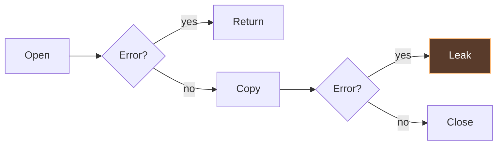
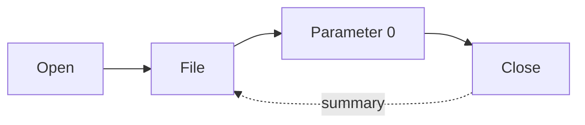
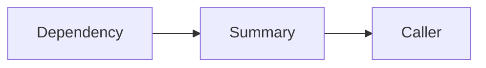

<div class="hero">
<div>
<div class="eyebrow">GolangNYC · James Ko</div>
<h1>Who<br>cleans up?</h1>
<p class="subtitle"><strong>gohawk</strong></p>
</div>

</div>

<!--
SECTION 1 — 8 minutes total, slides 1–7. Elapsed target: 08:00.
Spend about 45 seconds here. Introduce yourself and the project in your own words.
This talk assumes familiarity with Go functions, errors, defer, and goroutines.
The question for the hour: when a function starts something, who owns finishing it?
No live network or running external worker is needed for any example.
-->

---

# Spot the bug.

<<< @/examples/resources.go#leaky

<!--
Context for the speaker: Read a short header, then close the file. Take 30 seconds.

Spend about 1 minute. Pause before explaining anything. Ask for a show of hands:
who sees a problem, and on which line? Let someone describe the error path.
This is an actual compiled snippet, shared with the example validation.
Do not claim Close errors never matter: the happy path deliberately returns its error.
-->

---

# The missed return.

<<< @/examples/resources.go#leaky {6-8}

<!--
Context for the speaker: io.CopyN can fail: a short input or a failing destination is enough.

Spend about 45 seconds. Success closes the descriptor. A successful Open followed
by a failed CopyN returns before Close. A short input is a very ordinary trigger.
Repeated use in a long-lived process can accumulate open descriptors.
Distinguish a reachable return from an imaginary combination of incompatible branches.
-->

---

# Two paths.



<!--
Context for the speaker: The obligation begins after acquisition succeeds.

Spend about 45 seconds. Walk the picture with the audience. Open failure creates no
file cleanup obligation. The lower copy-error branch is the witness for this bug.
Explain what path-sensitive means using this picture before introducing the term.
Static analysis considers code paths without waiting for production to take them.
-->

---

# Defer it.

<<< @/examples/resources.go#fixed {6}

<!--
Context for the speaker: For this read-only example, defer covers both later returns.

Spend about 45 seconds. Defer moves the duty to function exit, immediately
after success. The file is used for reading, so this example ignores the deferred
Close error. Write/flush/commit code may need to preserve a finalization error.
Acknowledge the obvious objection: yes, defer is the right habit here.
Now ask what happens when this function must return the file still open.
-->

---

# Just add defer?

<<< @/examples/resources.go#validation-leak {8-11}

<!--
Spend about 90 seconds. This function reads a four-byte header and returns the
open file, positioned for the caller to continue reading. A short file makes
ReadFull fail. Which return still owns the file? Let the audience explain it.
Adding defer file.Close immediately after Open would close the returned file on
success. Returning the file transfers ownership only on the successful path;
returning nil with an error leaves this function responsible for closing it.
The analyzer reports this missing-release example in the validated examples.
-->

---

# Close here. Or hand it on.

<<< @/examples/resources.go#validation-fixed {8,11}

<!--
Spend about 90 seconds. On failure, close before returning the error. On success,
return the live file and let the caller own Close. The read failure is the primary
error; this read-only example deliberately ignores a secondary Close error.
The header read is intentionally minimal: it establishes that four bytes exist,
not that they match a particular format. The caller continues after those bytes.
This accepted form is analyzed beside the leaking form. The useful question is
which paths still owe cleanup, rather than whether the function contains defer.
Bridge to gohawk: keep that ownership question in mind across helpers and packages.
-->

---
class: section
---

# Meet gohawk.

<!--
SECTION 2 — 10 minutes total, slides 8–14. Elapsed target: 18:00.
Spend about 45 seconds. Describe the scope narrowly. This is a domain-focused
analyzer suite. Avoid claims that it proves all Go code safe or replaces tests.
Source: repository README and docs/analyzers/.
-->

---

# There it is.

<div class="terminal">
<p>owned resource from os.Open is not<br>released on every return path</p>
</div>

<!--
Context for the speaker: Check: resourcelifetime/missing-release · message text from the analyzer

Spend about 90 seconds. This is the actual message, presented without terminal
chrome or a fabricated line number. The analyzer can attach related return-path
evidence. Run the checked examples later if time allows; the deck is self-contained.
Source: internal/analysis/analyzers/resources/resourcelifetime/analyzer.go.
-->

---

# Who finishes?

<div class="steps">
<div class="step"><b>FILE</b><span>Close</span></div>
<div class="step"><b>TRANSACTION</b><span>Commit / rollback</span></div>
<div class="step"><b>WORKER</b><span>Join</span></div>
<div class="step"><b>PROCESS</b><span>Wait</span></div>
</div>

<!--
Context for the speaker: Each check has its own contracts and limits. Process ownership is experimental.

Spend about 90 seconds. These are analogies, not interchangeable operations.
Cancel requests a stop; it does not generally establish worker completion.
SQL rows and statements are also covered resource families. Stay with the four
rows rather than turning the talk into the entire analyzer catalog.
Sources: public resourcelifetime, goroutineownership and processownership pages.
-->

---

# Who waits?

<<< @/examples/workers.go#unjoined

<!--
Context for the speaker: The worker promises Done. Who waits for it?

Spend about 90 seconds. A callback is supplied so no fake updateCache body is
needed. The callback may do arbitrary work; the visible deferred Done establishes
the completion mechanism. The launching function returns with no Wait.
Do not say every goroutine without Wait is reported. A recognizable completion
obligation is the positive evidence this check starts from.
-->

---

# Join it.

<<< @/examples/workers.go#joined {9}

<!--
Context for the speaker: Joining is one part of lifecycle design. Blocking work still needs a way to stop.

Spend about 1 minute. Wait makes completion observable before returning. This is
suitable for finite work; it does not solve cancellation of an indefinitely blocked
callback. Discuss errors, cancellation and errgroup verbally if asked.
The accepted example is checked against the same analyzer as the bad example.
-->

---

<div class="eyebrow">Experimental</div>

# And processes?

<<< @/examples/processes.go#process {6-9}

<!--
Context for the speaker: processownership/missing-wait · experimental, explicitly selected

Spend about 1 minute 45 seconds. There is positive evidence of intended ownership:
one branch waits, another does not. If Start fails there is no started process to
reap. If Start succeeds and wait is false, the duty is abandoned.
The check deliberately does not report all fire-and-forget starts. Opening a
browser or relaunching a daemon may be intentional. The external worker is never
executed during validation: examples are compiled and analyzed only.
-->

---

# Choose your checks.

```sh
gohawk ./...
gohawk list

gohawk -enable=resourcelifetime,goroutineownership ./...

gohawk -enable-checks=processownership/missing-wait ./...
```

<!--
Context for the speaker: Conservative defaults. Experimental checks are an explicit choice.

Spend about 1 minute. The default command runs the core selection. Naming analyzers
selects their core checks; naming an experimental check selects it explicitly.
Avoid recommending enable-all as a first experience. The catalog can evolve, so
use list and doc from the installed version. Source: docs/configuration.md.
-->

---
class: section
---

# Across helpers.

<!--
SECTION 3 — 15 minutes total, slides 15–23. Elapsed target: 33:00.
Spend about 45 seconds. We have explained the bugs before the machinery.
The next section is an explanation of a bounded model, not a formal proof that
all resources in every program are accounted for.
-->

---

# Still closed.

<<< @/examples/resources.go#helpers

<!--
Context for the speaker: The cleanup action is inside closeFile, not the caller.

Spend about 2 minutes. Ask whether a search for the text file.Close in the caller
would understand this example. It would not. Explain that this is still an ordinary
accepted form: the helper releases the exact argument supplied by this caller.
The example is imported directly from the validated Go source.
-->

---

# Remember the promise.

<div class="two">
<div class="panel">
<h2>Helper</h2>
<p>Closes parameter 0.</p>
</div>
<div class="panel">
<h2>Caller</h2>
<p>Parameter 0 = this file.</p>
</div>
</div>

<!--
Spend about 2 minutes. A function summary records selected behavior rather than
copying the helper's entire implementation into each caller. Lifecycle facts can
be exported and imported across package boundaries. A name like closeFile alone
is insufficient; the body or a known API contract must supply evidence.
This is a conceptual projection of the actual summaries, not a serialized schema.
Source: docs/development/fact-model.md and docs/architecture.md.
-->

---

# The same file.



<!--
Context for the speaker: Closing a different file would not settle this obligation.

Spend about 90 seconds. Follow one identity through the arrows. Distinguish exact
binding from a vague claim that some cleanup method was called somewhere.
A helper could close a different resource, conditionally close, or retain its input.
Those require different evidence. Do not present this simplified picture as the
full heap or alias model.
-->

---

# Follow the value.

```text
file₁, err₁ = Open(path)
if err₁ != nil → return
copyErr₁ = CopyN(dst, file₁, 64)
if copyErr₁ != nil → return     ← file₁ still owed
Close(file₁)
```

<!--
Context for the speaker: Teaching notation, not a literal dump of Go’s SSA representation.

Spend about 2 minutes. Define SSA before using the abbreviation elsewhere.
Real Go SSA represents tuple calls and extracts separately; this slide intentionally
uses readable pseudocode. Explain that the analyzer can distinguish a reassigned
variable from the original resource. Branch joins and aliasing add complexity;
we will not derive the whole intermediate representation on stage.
-->

---

# Find → classify → follow

<div class="steps">
<div class="step"><span>Obligation</span></div>
<div class="step"><span>Actions</span></div>
<div class="step"><span>Returns</span></div>
</div>

<!--
Context for the speaker: A shared lifecycle pattern; each analyzer supplies its own evidence rules.

Spend about 2 minutes. This is the lifecycle architecture, simplified for the room.
Some classifiers call exact completion a join. Resource cleanup and ownership
transfer are separate labels even when both remove a reportable local obligation.
One authoritative flow result drives reporting and tracing. Avoid suggesting every
analyzer shares an identical implementation or every domain uses the same walk.
Source: docs/architecture.md, lifecycle analyzer section.
-->

---

# Unknown is an answer.

<div class="two">
<div class="panel"><h2>Cleanup / transfer</h2><p>No report.</p></div>
<div class="panel"><h2>Unknown</h2><p>No report.</p></div>
</div>

<!--
Context for the speaker: Unknown suppresses a diagnostic. It does not certify the program safe.

Spend about 90 seconds. A positive unknown action is not equivalent to observing
nothing. If the value crosses an opaque boundary, a conservative analyzer cannot
assume the receiver ignores it. A different early-return path still needs its own
classification: one handoff does not excuse every path in the function.
The last row says may because final reporting can include other policy exclusions.
-->

---

# Across packages.



<!--
Context for the speaker: Result, lifecycle, and concurrency knowledge are separate components.

Spend about 90 seconds. Selected domains compute and publish their own facts.
The summary broker lets analyzers request the knowledge they need. Available facts
still may not answer a particular question. Exported declaration guarantees must
be instantiated against the actual call; a parameter index is not a caller value.
Source: docs/development/fact-model.md, selecting knowledge before analysis.
-->

---

# Built on go vet.

<div class="terminal">
<p>gohawk ./...<br>  → go vet -vettool=… -json<br>  → package analysis + cached facts<br>  → diagnostics</p>
</div>

<!--
Context for the speaker: Package-local SSA and reusable facts avoid loading the entire program’s SSA at once.

Spend about 1 minute 45 seconds. This is why cross-package summaries fit Go's
analysis infrastructure. The command delegates package scheduling and caching to
go vet, then processes diagnostics. Avoid memory or speed numbers without a pinned
measurement. Cache invalidation follows source, dependency and tool changes.
Source: docs/architecture.md, how a run is driven.
-->

---
class: section
---

# Warnings cost attention.

<!--
SECTION 4 — 10 minutes total, slides 24–30. Elapsed target: 43:00.
Spend about 45 seconds. Explain the project's precision-first goal as a design
choice. No claimed precision percentage: the deck does not contain a fresh corpus
measurement. A trustworthy diagnostic should point toward an actionable change.
-->

---

# A leak?

<<< @/examples/resources.go#transfer

<!--
Context for the speaker: The resource leaves through the return value. The caller takes over.

Spend about 90 seconds. Pause and let the audience identify the transfer. A search
for missing local Close would flag a standard constructor-like API. This accepted
example is validated alongside the leaky one. Returning the resource does not
prove its eventual caller will close it; it changes the local ownership question.
-->

---

# Dropped or handed on?

<div class="two">
<div class="panel">
<h2>Dropped</h2>
<p>Open → return</p>
</div>
<div class="panel">
<h2>Transferred</h2>
<p>Open → new owner</p>
</div>
</div>

<!--
Context for the speaker: The evidence is about values and paths, not variable names.

Spend about 90 seconds. These are the two resource examples side by side at the
policy level. A function called closeEverything is not evidence by its spelling.
Returning an unrelated file would not transfer this one. A returned wrapper can
require deeper ownership evidence; it is outside this simple example.
-->

---

# Silence ≠ safety.

<div class="steps">
<div class="step"><span>Covered</span></div>
<div class="step"><span>Unknown</span></div>
<div class="step"><span>Outside scope</span></div>
</div>

<!--
Spend about 90 seconds. Work without a recognizable completion signal is a good
example of outside scope for goroutineownership. A callback handed to unknown
code can make ownership unknown. Budget exhaustion is unknown, not proof that
cleanup happened or that a defect exists. The audience should take away a bounded
contract, not a claim of whole-program correctness.
-->

---

# Test the lookalikes.

<div class="two">
<div class="panel">
<h2>Report</h2>
<p>Leak · abandoned join</p>
</div>
<div class="panel">
<h2>Accept</h2>
<p>Helper · transfer · join</p>
</div>
</div>

<!--
Context for the speaker: Predict the false positives before extending a check.

Spend about 90 seconds. Explain regression fixtures: small programs represent
specific evidence boundaries. A positive fixture only shows a check can fire.
Accepted lookalikes establish where it must stay silent. This is a development
practice, not a statistical precision claim. The talk examples are a tiny teaching
set and do not replace the analyzer's larger local testdata suite.
-->

---

# Into the wild.

<div class="steps">
<div class="step"><span>Run</span></div>
<div class="step"><span>Review</span></div>
<div class="step"><span>Minimize</span></div>
<div class="step"><span>Replay</span></div>
</div>

<!--
Context for the speaker: Dogfooding finds the ownership patterns a synthetic example missed.

Spend about 90 seconds. A report is a candidate until reviewed in context. Check
framework lifecycle, registered callbacks and helper behavior before calling it a
bug. If a recurring false positive appears, fix the general evidence boundary
rather than adding a project-name exemption. No audit counts on this slide.
Source: AGENTS.md precision policy and development audit guidance.
-->

---

# Precision first.

<p class="statement">Don’t flag<br><strong>correct code.</strong></p>

<!--
Context for the speaker: Keep uncertain ownership uncertain.

Spend about 1 minute 45 seconds. Take a quick question or ask for an example of a
linter warning the room has stopped trusting. Explain the cost of false positives:
review effort, suppressions, and warnings being ignored. High precision is the goal,
not a promise of zero false positives. Broader heuristic checks remain experimental.
Bridge: here is what a reviewed report can turn into in a real project.
-->

---
class: section
---

# Docker. A missing Wait.

<!--
Context for the speaker: moby/moby #53517 · Reap nft process on errors

SECTION 5 — 7 minutes total, slides 31–36. Elapsed target: 50:00.
Spend about 45 seconds. The linked PR explicitly attributes discovery to gohawk's
processownership check. Do not imply the static analyzer proved the pipe deadlock.
The same review found both incomplete process cleanup and sequential pipe draining.
Status/merge claims are intentionally omitted: this slide explains the patch.
-->

---

# One report. Two bugs.

<div class="two">
<div class="panel">
<h2>gohawk found</h2>
<p>A skipped Wait.</p>
</div>
<div class="panel">
<h2>Review found</h2>
<p>A pipe deadlock.</p>
</div>
</div>

<!--
Context for the speaker: Simplified account of the linked patch; separate findings, related code.

Spend about 1 minute 15 seconds. Parent waits for stdout EOF while child cannot
exit because it is blocked writing stderr. The PR's reproduction replaces nft with
a program emitting more than a pipe buffer of stderr. The regression uses 4 MiB.
The missing-Wait error paths were the analyzer finding. The deadlock explanation
came from review and a reproduction; do not attribute general deadlock detection.
-->

---

# Let Run handle it.

```go
// Simplified from the proposed Docker patch.
cmd.Stdin = bytes.NewReader(nftCmd)
cmd.Stdout = &stdoutBuf
cmd.Stderr = &stderrBuf

if err := cmd.Run(); err != nil {
    return fmt.Errorf("running nft: %s %w", stderrBuf.String(), err)
}
```

<!--
Context for the speaker: Run manages stream copying and waits after a successful start.

Spend about 1 minute 15 seconds. Setting Stdout and Stderr to non-file writers lets
os/exec manage copying concurrently. Run is Start followed by Wait. The real patch
also includes a regression test and error context. This code is a labeled excerpt,
not a complete runnable function or a talk example checked by gohawk.
Pinned patch commit: 4070d0ac379e4b5adde89e41f6d94d202630d960.
Source: https://pkg.go.dev/os/exec#Cmd.Run and the linked PR diff.
-->

---

# Try it.

```sh
go install github.com/kojah/gohawk@latest

gohawk ./...
```

<!--
Context for the speaker: Start with default checks. Review the first finding in its ownership context.

Spend about 1 minute. Installation prerequisites follow the installed version:
use the installation page or a release binary for the host toolchain and platform.
For the live demo, use the already-built binary and examples, not the network.
Source: README.md and docs/installation.md. Do not enable all experimental checks
on an unfamiliar large repository as the first demo.
-->

---

# Make it routine.

<div class="two">
<div class="panel">
<h2>Use it</h2>
<p>Pin. Run. Review.</p>
</div>
<div class="panel">
<h2>Improve it</h2>
<p>Small reproductions.</p>
</div>
</div>

<!--
Context for the speaker: Also available as a module plugin in a custom golangci-lint binary.

Spend about 1 minute. golangci-lint integration requires a custom binary; it is not
a claim that a stock distribution bundles gohawk. The docs have the build recipe.
Invite reports of false positives with exact version, code, flags, and intended
lifecycle. Tests and source review remain part of the workflow.
-->

---

# Who cleans up?

<p class="statement">Open → ? → Close</p>

<!--
Spend about 1 minute 45 seconds. Close the narrative with the same opening example.
The core idea survives files, workers and child processes, but each check requires
its own evidence. Invite the room to try the tool and challenge the boundaries.
Next slide begins the reserved ten-minute Q&A.
-->

---
class: section
---

# Your questions.

<p class="subtitle"><strong>gohawk.dev</strong></p>

<!--
Context for the speaker: Questions about ownership, safe lookalikes, summaries, or adoption?

SECTION 6 — 10 minutes Q&A. Finish target: 60:00.
Keep this slide up during questions. Backup slides follow; skip them in the planned
50-minute presentation. If asked about precision rates or speed, explain that these
need a pinned version, a corpus and reviewed measurements. Do not improvise numbers.
-->

---

<div class="eyebrow">Backup / scope</div>

# The limits.

- Silence ≠ safety
- Cancellation ≠ completion
- Unknown stays unknown

<!--
Context for the speaker: Each diagnostic is bounded by its check’s documented evidence model.

Backup only. These are useful clarifications for Q&A. Explain the specific check
boundary rather than defending an overly broad marketing claim. For a concrete
unreported case, inspect the actual version and trace before promising coverage.
-->

---

<div class="eyebrow">Backup / process lifecycle</div>

# Run.

<<< @/examples/processes.go#processfixed

<!--
Context for the speaker: Use Start + Wait when the work genuinely needs a split lifecycle.

Backup only. Run handles the simple case. For a long-lived child, explain ownership,
stream draining and shutdown separately; blindly deferring Wait may hang if nothing
causes the child to exit. This accepted example is compiled and analyzed, not run.
-->

---

<div class="eyebrow">Backup / sources</div>

# Sources.

- [Resource lifetime](https://gohawk.dev/analyzers/resources-and-lifecycle/resourcelifetime/)
- [Goroutine ownership](https://gohawk.dev/analyzers/concurrency-and-synchronization/goroutineownership/)
- [Process ownership](https://gohawk.dev/analyzers/resources-and-lifecycle/processownership/)
- [Architecture and summaries](https://github.com/kojah/gohawk/blob/main/docs/architecture.md)
- [Docker patch and reproduction](https://github.com/moby/moby/pull/53517)

<!--
Context for the speaker: Pinned source references and rehearsal instructions live in this deck’s README.

Backup only. Sources are recorded in README.md at the gohawk revision used to draft
the deck. Code examples come from the neighboring examples module. Revalidate the
examples after upgrading gohawk. No benchmark or audit-rate claims are made here.
-->
